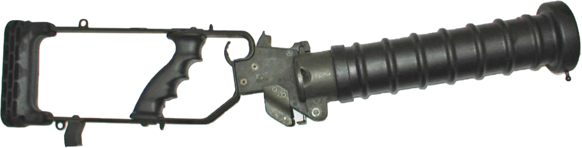

# Cougar
<figure class="thumb" markdown="span">
  
  <figcaption>{{legende de l'image}}</figcaption>
</figure>

!!! danger "Description"
	{{Description brève de l'arme, de son apparence et de ses principaux effets possibles.}}

!!! warning "Protection"
    {{Équipements utile pour résister, limites de protection et liens vers les fiches EPI.}}

!!! injury "Blessures"
    {{Principales blessures possibles et liens vers les fiches médicales adaptées.}}

## Détails techniques

### Description
{{Description détaillé de l'arme}}
### Usage légal
{{Description de l'utilisation légal de l'arme}}
### Usage réel documenté
{{Comment l'arme est réellement utilisé}}
## Blessures associées
### Type de blessure
#### Comment la reconnaître
{{Description de comment reconnaitre la blessure dû à l'arme)}}
#### Images et documentation (TW)
{{Image/Vidéo des blessures dû à l'arme)}}
## Sources
- [Source 1](https://example.org)
- [Source 2](https://example.org)
## Révision
- **Statut :** {{}}
- **Dernière vérification :** {{AAAA-MM-JJ}}
