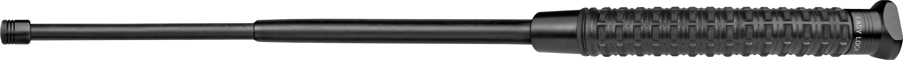

# Matraque Téléscopique
<figure class="thumb" markdown="span">
  
  <figcaption>Légende courte. Source: ... Licence: ...</figcaption>
</figure>

!!! danger "Description"
    Résumé du dispositif, de son apparence et de ses principaux effets possibles.

!!! warning "Protection — Équipements"
    Équipements pertinents, limites de protection et liens vers les fiches EPI.

!!! injury "Soins — Blessures associées"
    Principales blessures possibles et liens vers les fiches médicales adaptées.

## Détails techniques

### Description

### Usage légal

### Usage réel documenté

## Blessures associées

### Type de blessure

#### Comment la reconnaître

#### Images et documentation

## Sources

- [Source 1](https://example.org)
- [Source 2](https://example.org)

## Révision

- **Statut :** à vérifier
- **Dernière vérification :** AAAA-MM-JJ
