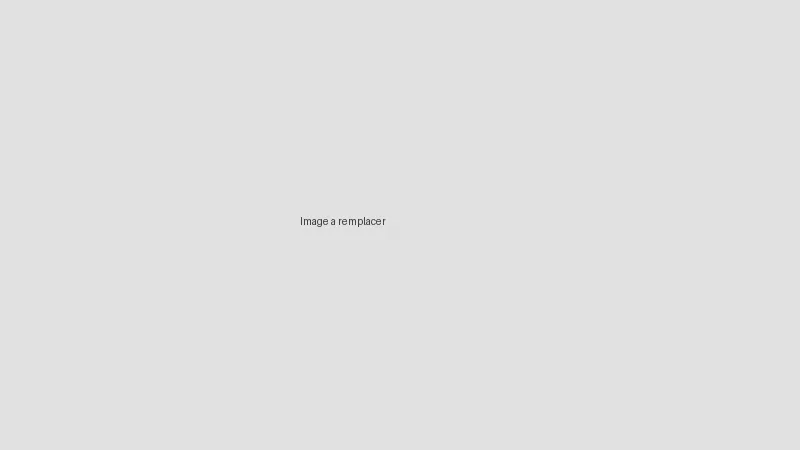

# En bref
Grenade qui projette des galets en caoutchouc à 360° autour du point d'explosion.

*Image à remplacer. Source: à compléter. Licence: à compléter.*

| Repère | Info |
|---|---|
| Catégorie | Munition |
| Effet | Souffle et projection de galets |
| Vecteur | Lancer à la main, portée de 2 à 10 m (à vérifier) |
| Blessures typiques | Plaies aux mains et au visage, traumatisme oculaire, contusions multiples |
| Protection clé | [[lunettes-anti-impact]] |
## À retenir
- Conçue pour disperser une foule proche.
- Une explosion peut faire plusieurs victimes, ce qui complique le tri.
# Reconnaître en détail
## Apparence
À compléter.
# Usage
## Usage légal
À compléter, avec source.
## Usage observé
À compléter, avec source. Aucun nom de personne.
# Blessures et soins
## Cas particuliers
Plusieurs personnes touchées par une seule explosion: tri prioritaire.
# Sources
À compléter.
